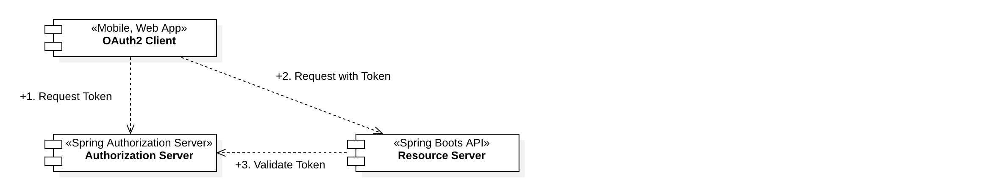

# Learning Spring Authorization Server

This project is created to learn Spring Authorization Server. Spring Authorization Server use OAuth2 Authorization and Open ID Connect standard.

## Concept of OAuth2 Authorization

The Authorization Server issues tokens and defines the authorization granted by those tokens. The Resource Server validates the tokens and enforces access rules. The Resource Server does not always contact the Authorization Server when it receives an API request.

There are two major token validation mechanisms in Spring Security:
1. **JWT validation** — Resource Server validates the token locally.
2. **Opaque token introspection** — Resource Server contacts the Authorization Server to validate the token.

### 1. JWT Validation

This is a common approach in Spring Security microservice architectures.

1. Authorization Server issues a digitally signed JWT access token.
2. Client sends the JWT to the Resource Server.
3. Spring Security's JwtDecoder validates the JWT signature using the Authorization Server's public key.
4. Spring Security checks the token's expiration, issuer and other configured validation rules.
5. Spring Security converts the validated token into an authenticated Authentication object.
6. Resource Server checks endpoint authorization rules, such as hasAuthority("SCOPE_read").

The Resource Server may retrieve and cache public signing keys from the Authorization Server's JWKS endpoint, but it does not need to call the Authorization Server for every API request.

### 2. Opaque Token Introspection Mechanism

When the Resource Server receives an opaque access token, it sends the token to the Authorization Server's introspection endpoint.